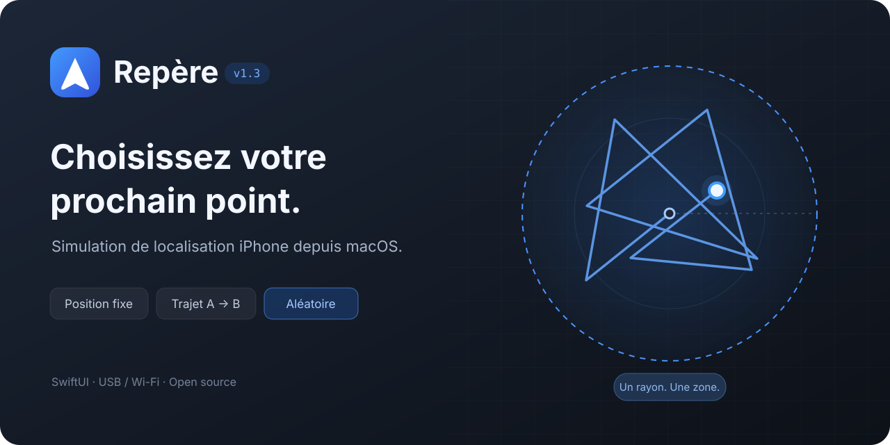

# Repère


[](Repere-source/LICENSE)

**Une carte sur le Mac pour simuler les déplacements de son iPhone.**

Repère permet de choisir une position, de suivre un trajet A → B ou de se déplacer continuellement dans un cercle. L’interface native réunit la carte, les réglages de déplacement, la connexion à l’iPhone et le journal de session.



*Illustration de présentation ; il ne s’agit pas d’une capture d’écran.*

Cette publication fournit les **sources à compiler sur son Mac**. Le fonctionnement sur un iPhone physique, y compris l’effet dans Localiser et Snapchat, reste à valider. Une commande envoyée au service développeur ne confirme pas la position affichée ou partagée par ces apps.

## Fonctionnalités

| Mode | Ce qu’il permet |
| --- | --- |
| **Position fixe** | Choisir un point sur la carte, rechercher une adresse ou saisir des coordonnées. |
| **Trajet A → B** | Tracer un itinéraire routier ou direct, choisir une durée ou une vitesse, mettre en pause et reprendre. Le point B est maintenu à l’arrivée. |
| **Aléatoire — nouveau en 1.3** | Choisir le centre d’un cercle et un rayon de **10 à 10 000 m**, puis se déplacer continuellement à **1–150 km/h** jusqu’à l’arrêt. |
| **Connexion** | Préparer l’iPhone en USB ou sélectionner une connexion Wi-Fi déjà configurée. |
| **Contrôle de session** | Suivre le point envoyé, consulter le journal et demander la restauration du GPS. |

Le mode Aléatoire relie des points tirés dans le cercle par des segments directs. Il ne suit ni les routes, ni les bâtiments, ni les obstacles. Les modes Trajet et Aléatoire disposent de commandes **Pause** et **Reprendre**.

## Compatibilité

| Élément | État |
| --- | --- |
| **Mac** | macOS 14 ou ultérieur. Compilation et tests réalisés sur Apple Silicon. Compilation Intel non validée. |
| **Construction** | Outils de ligne de commande Xcode et **Python 3.14** installé localement. Dépendances Python épinglées. |
| **iPhone** | Association au Mac et services développeur disponibles ; mode développeur activé lorsqu’il est requis. La compatibilité dépend de la version d’iOS. |
| **Wi-Fi** | Mac éveillé, Repère ouvert et iPhone sur le même réseau. Le code exclut iOS 17.0–17.3 pour ce transport. Fonctionnement sur appareil non validé. |

Repère utilise les services de simulation développeur de l’iPhone. Il ne permet pas de cibler séparément Snapchat ou Localiser et ne masque pas l’indicateur de position simulée exposé par iOS. Aucun fonctionnement autonome avec le Mac éteint ou déconnecté du réseau n’est proposé.

## Installation depuis les sources

Installe les outils de ligne de commande Xcode (`xcode-select --install`) et Python 3.14, puis clone le dépôt :

```sh
git clone https://github.com/Matt3712/Repere.git
cd Repere
cd Repere-source
REPERE_PYTHON=python3.14 ./build.command
open ../Repere.app
```

Le script compile l’app dans **`../Repere.app`**, prépare son environnement Python isolé et applique une signature locale. Tu peux ensuite déplacer l’app dans Applications et l’ouvrir depuis le Finder.

L’app compilée reste liée au Python installé sur le Mac qui l’a construite. Copier son `.app` ou un DMG local sur un autre ordinateur ne constitue donc pas une installation portable. Cette version n’est pas notariée par Apple ; aucun DMG autonome n’est publié ici.

## Première connexion

1. Branche l’iPhone en USB, déverrouille-le et accepte **Faire confiance à cet ordinateur**.
2. Dans Repère, sélectionne l’iPhone et clique sur **Préparer la connexion**.
3. Si nécessaire, active **Réglages → Confidentialité et sécurité → Mode développeur** sur l’iPhone, puis redémarre et confirme. Si le réglage est masqué, la préparation tente de le rendre visible.
4. Relance la préparation. Un téléchargement développeur peut être nécessaire à la première utilisation.

Le [guide complet](LISEZ-MOI.md) décrit les prérequis et les étapes de dépannage.

## Utilisation

### Position fixe

Choisis **Position fixe**, place un repère ou recherche un lieu, vérifie les coordonnées puis clique sur **Appliquer la position**.

### Trajet A → B

Choisis **Trajet A → B**, place le départ et l’arrivée, puis sélectionne **Par la route** ou **Ligne directe** et clique sur **Tracer le trajet**. Règle une durée en minutes ou une vitesse, puis lance **Démarrer le trajet**. Les pauses prolongent la durée totale ; B reste maintenu à l’arrivée jusqu’à l’arrêt.

### Déplacement aléatoire

Choisis **Aléatoire**, place le centre du cercle par un clic, une recherche ou des coordonnées, puis règle le rayon et la vitesse. Clique sur **Démarrer l’aléatoire**. Le déplacement commence au centre, reste dans le cercle et se poursuit jusqu’à **Arrêter et restaurer le GPS**.

### Sans câble, sur le même réseau

Avec l’iPhone encore branché, active **Finder → iPhone → Général → Afficher cet iPhone lorsqu’il est en Wi-Fi**, puis **Appliquer**. Arrête la simulation USB, débranche le câble, sélectionne **Wi-Fi** dans Repère, actualise et prépare la connexion à nouveau. Le Mac doit rester éveillé et connecté au même réseau que l’iPhone. Ce transport reste à vérifier sur appareil réel.

Pour terminer une session, utilise **Arrêter et restaurer le GPS**, puis vérifie la position réelle sur l’iPhone. Si la restauration échoue, reconnecte l’appareil et réessaie ; redémarre-le si nécessaire.

## Sources et validation

Les sources SwiftUI, le pont Python et la carte se trouvent dans [`Repere-source`](Repere-source). `requirements.txt` fixe `pymobiledevice3` à **11.20.2** et `requirements.lock` fixe ses dépendances.

Depuis ce dossier, après construction :

```sh
../Repere.app/Contents/Resources/runtime/bin/python3 -m unittest discover -s . -p 'test_*.py'
./test_model.command
node test_map.cjs
```

Node.js est nécessaire uniquement pour le test de la carte. La validation comprend **86 tests Python**, **21 scénarios du modèle Swift** et les contrôles du protocole de carte. Les transports des tests sont simulés : ces résultats ne valident pas le GPS réel, Localiser, Snapchat ou une session Wi-Fi sur iPhone. Les limites sont détaillées dans le [rapport de vérification](docs/VALIDATION.md).

## Services et données

La carte charge les tuiles OpenStreetMap ; les recherches sont envoyées à Photon et les demandes d’itinéraire routier à OSRM. Les segments directs et le déplacement aléatoire sont calculés localement. Les serveurs publics nécessitent Internet et leur disponibilité n’est pas garantie.

L’app ne demande aucun identifiant Apple ou Snapchat. Les informations d’association et les images développeur restent dans `~/Library/Application Support/Repere`. Le guide décrit les services utilisés et les options de serveur personnel.

## Crédits et licence

- [pymobiledevice3](https://github.com/doronz88/pymobiledevice3) — communication avec les services développeur de l’iPhone.
- [Leaflet](https://leafletjs.com/) — carte interactive.
- [OpenStreetMap et ses contributeurs](https://www.openstreetmap.org/copyright) — données cartographiques.
- [Photon](https://github.com/komoot/photon) — recherche de lieux.
- [OSRM](https://project-osrm.org/) — calcul des itinéraires routiers.
- [AirCard](https://github.com/Mak5er/AirCard) — inspiration pour la présentation de l’interface et l’organisation de la documentation. Le texte et les visuels de Repère sont propres à ce projet.

Repère est distribué sous [GNU GPL version 3](Repere-source/LICENSE). Les composants tiers conservent leurs licences et attributions.
